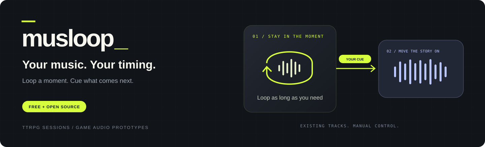
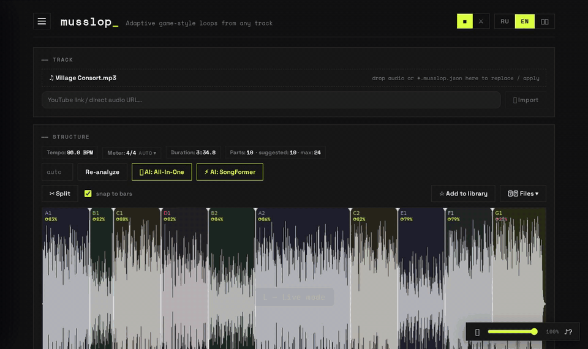

<p align="center">
  
</p>

<h3 align="center">Make your music fit the scene.</h3>

<p align="center">
  <a href="https://www.python.org/"></a>
  <a href="https://fastapi.tiangolo.com/"></a>
  <a href="https://developer.mozilla.org/docs/Web/API/Web_Audio_API"></a>
  <a href="https://github.com/ASLP-lab/SongFormer"></a>
  <a href="https://github.com/mir-aidj/all-in-one"></a>
  <a href="LICENSE"></a>
</p>

<p align="center">
  <b>Your existing music. You decide when it moves on.</b><br>
  Loop a section · cue the next one · export loops for your game
</p>

**musslop** is a free, open-source tool for adapting music tracks to the pacing of
**TTRPG sessions and video game prototypes**. Keep a section looping while a scene
unfolds, then hit **Next** to cue a transition on a musical boundary.

You control the transitions yourself: musslop doesn't listen to your session or
automatically react to gameplay. It helps you work with existing tracks rather than
generating new music.

<p align="center">
  
</p>
<p align="center"><em>30-second silent demo: select → loop → cue → transition.</em></p>

**Free and open source (MIT).** No subscriptions, accounts, registration, or email
collection. Runs locally and works offline after the required dependencies and
models have been downloaded. This is a personal passion project, shared freely.

[What's new](#whats-new) · [Quick start](#quick-start) · [Your first loop](#your-first-loop) · [Example](#example-one-track-step-by-step) · [Features](#features) · [Under the hood](#under-the-hood)

**Read about the project:** [Article on Habr (in Russian)](https://habr.com/ru/articles/1086674/).

## What's new

<p align="center">
  
</p>
<p align="center"><em>Live mode: play → cue a scene → pick another track (T) → it fades in and keeps playing → next track (]).</em></p>

**Run a whole session from one screen**
- **Live mode** (`L`) — a full-screen desk for the table: what's playing now, what comes next
  and in how many seconds, big pads for parts and scenes, **Next**, **Cancel** and **Fade out** (`F`).
  Editing is locked so nothing breaks mid-session.
- **Switch tracks inside Live** — ◀ / ▶ (or `[` / `]`) step through your set list, `T` opens a
  searchable track list. The current track fades out while the next one loads, and the music
  keeps going on the new track.
- **Scenes** — save a moment of the game (*Exploration*, *Something is close*, *Ambush*) as a
  scene: which part loops, layers, speed, reverb and how to enter it. Fire them with
  **Shift+1–9**, from any track.
- **Projects (set lists)** — group tracks and scenes for a session or a game level, with notes,
  and open any of them in one click.
- **Music folders** — point musslop at a folder on your disk and every track inside is one
  click away (☰ → Folders).

**Transitions that land where you want**
- **Cue any part** — click a part or press **1–9, 0** while music plays. Pick when it switches:
  **at loop end**, **at phrase** (next 4/8 bars) or **right away**. **Backspace** cancels.
- **Audition the seam** — ⟲♪ plays the loop seam and →♪ the transition into the next part, so
  you can check a boundary in 6 seconds instead of waiting for the whole loop.

**Meter (time signature)**
- musslop now **detects the meter** (3/4 vs 4/4) instead of assuming 4/4 for every track; it is
  shown next to the BPM. Waltzes and other 3/4 tracks get a correct bar grid, loops and phrases.
- Not right? Click the badge: choose **2/4 … 7/4, 6/8**, or **shift the downbeat** by a beat. The
  original (detected) meter stays the recommended default, and your choice is saved with the track.

**For game developers**
- **Loop export with `manifest.json`** — loop points, bar lines, phrase transition points,
  stingers, scenes and the meter, ready for your engine. See the [Godot 4 example](examples/godot).
- **Foundry VTT export** — Files → Foundry VTT (zip) gives you a ready-to-import playlist.

**Smaller things**
- A clearer page: Scenes now sit below the player, and a shorter header.
- Install scripts check your Python version and use tested library versions, so setup breaks
  less often. They also explain what to do on an unsupported system (for example, Intel Macs
  for the AI engines).

## Two ways to use it

| At your TTRPG table | While building your game |
|---|---|
| Keep an atmospheric section going while players explore or talk. Cue the intense part when **you** decide it's time. | Audition section loops, transitions, and intensity changes before implementing them in your game. |
| Operate the soundtrack live with Play and Next. A Tavern UI theme is available in the header. | Export WAV loops for your audio workflow. Playback logic and engine integration remain part of your game project. |

## Features

| Feature | What it does |
|---|---|
| **Structure analysis** | a fast heuristic mode is included in the base setup. Optional [SongFormer](https://github.com/ASLP-lab/SongFormer) and [All-In-One](https://github.com/mir-aidj/all-in-one) models detect and label sections; neural beat/downbeat tracking uses [Beat This!](https://github.com/CPJKU/beat_this) |
| **Loop playback** | sample-accurate Web Audio scheduling, bar-snapped boundaries, per-section loop-quality score (⟳%), equal-power crossfades |
| **Intensity layers** | Demucs splits the track into drums / bass / vocals / backing — toggle and mix layers live: calm exploration → full combat, same track |
| **Transition controls** | outgoing tails, bass-swap, and one-shot stingers (cymbal / boom / riser) help shape section changes |
| **Build-up detection** | suggests crescendo sections that should play once rather than repeat; loop behaviour is editable |
| **Full editor** | drag boundaries with bar snapping, split/merge, loop-start markers, Ctrl+Z, zoom + scrollbar, everything auto-saved |
| **Audition the seam** | ⟲♪ plays the last seconds of a part and then its start; →♪ plays the end of a part into the next one — check a boundary in 6 seconds instead of a whole loop |
| **Cue any part** | while playing, click any part — or press its key **1–9, 0** (parts 1–10) — to queue a transition into it — **at loop end**, **at phrase** (next 4/8-bar boundary) or **right away** (short crossfade); cancel with Backspace |
| **Scenes** | save the player state (part + layers + speed/crossfade/reverb + how to enter) as a named scene with a hotkey Shift+1–9: *Empty corridor*, *Something is close*, *Ambush*, *Aftermath* — all from one track |
| **Live mode** | full-screen desk for the session (key `L`): big current/next display, scene pads, ETA of the transition, fade-out, switch tracks without leaving it (◀ ▶, `[` `]`, `T` for the list) — editing is locked |
| **Projects (set lists)** | group tracks and scenes for a whole session or level (*Arrival → Inside → Finale*), with notes; open any item in one click |
| **Meter** | time signature detected automatically (3 vs 4 beats; neural engines read it from their downbeats) and shown next to BPM; override it (2/4 … 7/4, 6/8) and shift the downbeat if the bar grid is off — the original meter stays the recommended default |
| **Loop export** | ZIP of WAV sections plus `manifest.json` (loop points, phrase transition points, tails, stingers, scenes) — see the [Godot example](examples/godot) |

**Results depend on the source track.** Automatic boundaries are a starting point,
not a guarantee of perfect loops. Listen to the repeat and transition, adjust the
boundaries, and tune the crossfade when needed. Stem separation can introduce artifacts.

## Quick start

Requires **Python 3.10+** and **Git** for the clone commands below.
The base setup includes heuristic analysis, editing, playback, and loop export;
you can try those before installing the optional neural engines.

Linux / macOS:

```bash
git clone https://github.com/Siziff/musslop.git && cd musslop
./setup.sh   # creates .venv, installs everything (incl. a bundled ffmpeg)
./run.sh     # → http://localhost:8801
```

Windows (needs [Python 3.10+](https://python.org) with "Add to PATH" checked):

```bat
git clone https://github.com/Siziff/musslop.git
cd musslop
setup.bat
run.bat      # → http://localhost:8801
```

ffmpeg is downloaded automatically with the dependencies — no manual install needed.

### Docker

No Python needed — just [Docker](https://docs.docker.com/get-docker/) (Docker Desktop on Windows / macOS):

```bash
git clone https://github.com/Siziff/musslop.git && cd musslop
docker compose up -d        # → http://localhost:8801
```

- The image is about 600 MB and runs on x86_64 and arm64 (Apple Silicon, Raspberry Pi 4/5).
- Your tracks, markups and projects live in the `musslop-data` volume and survive updates:
  `git pull && docker compose up -d --build`.
- To use ☰ → **Folders**, uncomment the music folder line in `docker-compose.yml`
  and add `/music` inside musslop. The *Pick folder…* dialog does not work in Docker; type the path.
- The AI engines (SongFormer, All-In-One) are not included: they need several GB of PyTorch.
  Use the native setup for them.
- By default the app is only reachable from this computer. To open it to your LAN (e.g. a tablet
  at the table), change the port line to `"8801:8801"`.

Without Compose: `docker build -t musslop .` then
`docker run -d -p 8801:8801 -v musslop-data:/data musslop`.

## Your first loop

1. Open **http://localhost:8801** after starting the server.
2. Drop an audio file into the track area and let the base analysis identify sections.
3. Check a boundary with **⟲♪** (loop seam) or **→♪** (transition into the next part)
   on its chip; drag the boundary on the waveform if the seam is audible.
4. Select a section and press **Play** (or **Space**) to loop it.
5. Press **Next** (or **→ / Enter**) — or click any other part — to queue a transition.
   Pick when it lands: **at loop end**, **at phrase** (4/8 bars), **right away** (short crossfade).
   **Backspace** cancels a queued transition.
6. Adjust section boundaries if needed; use **Ctrl+Z** to undo an edit.
7. For game audio prototyping, choose **Files → Loops (zip)** to export WAV loops
   with `manifest.json`.

## Running a session

1. Set up the player for a moment of the game (part, layers, speed, reverb) and hit
   **Save scene**. Repeat for every mood you need from this track. Scenes get hotkeys Shift+1–9; plain digits 1–9, 0 cue parts 1–10.
2. Optionally create a **Project** (☰ → Project): groups like *Arrival / Inside / Finale* with the
   tracks and scenes of the session, plus notes. Items open in one click and start their scene.
   ☰ → Folders lets you point musslop at your music folder so every file is one click away.
3. At the table press **L** for **Live mode**: a full-screen desk with the current part, what
   comes next and when, scene pads, **Next**, **Cancel** and **Fade out** (`F`). Switch tracks
   right there: **◀ / ▶** or `[` / `]` step through the open project (or your library), `T`
   opens a searchable track list. Editing shortcuts are disabled while Live is on; `Esc` leaves it.

## Example: one track, step by step

**Track:** Splendorius — *Oblivion Roses* (≈ 3:27, 77 BPM). The audio is not included;
use your own copy, or any track.

What the **SongFormer** engine (⚡) produced: 9 parts with musical names, every part loops.

| Part | Time | Length | Loop quality |
|---|---|---|---|
| Intro | 0:00.0–0:25.7 | 26 s | 69% |
| Verse | 0:25.7–0:51.3 | 26 s | 85% |
| Inst | 0:51.3–1:04.1 | 13 s | 68% |
| Verse 2 | 1:04.1–1:29.7 | 26 s | 88% |
| Chorus | 1:29.7–1:55.3 | 26 s | 84% |
| Inst 2 | 1:55.3–2:08.1 | 13 s | 83% |
| Chorus 2 | 2:08.1–2:33.7 | 26 s | 86% |
| Inst 3 | 2:33.7–2:59.4 | 26 s | 84% |
| Chorus 3 | 2:59.4–3:26.6 | 27 s | 76% |

- **Functional names.** The neural engine names parts by their role (Intro, Verse, Chorus,
  Inst = instrumental). The fast engine without AI uses letters instead (A1, B1, A2 …), where
  the same letter means the same music.
- **Loop quality** shows how cleanly the end joins back to the start. Above ~75% the seam is
  usually inaudible, so most parts here loop cleanly. Intro and Inst (~69%) are worth a listen
  with ⟲♪.
- **Meter** is kept as SongFormer detected it (`"meter_manual": false`). If the bar grid on the
  waveform doesn't match what you hear, pick another meter on the badge next to the BPM.

Two scenes are saved on top: *Exploration* loops the Verse, and *Something is close* moves to
the Chorus on the next phrase. At the table that's **Shift+1** while players look around and
**Shift+2** when it gets tense.

### The markup file

**Files → ⤓ Markup** downloads a `*.musslop.json`. Drop it into musslop
together with the audio to restore everything. The full file for this example is
[`examples/markup/Splendorius - Oblivion Roses.musslop.json`](examples/markup/Splendorius%20-%20Oblivion%20Roses.musslop.json);
shortened:

```json
{
  "track": "Splendorius — Oblivion Roses",
  "tempo": 77,
  "beats_per_bar": 2,
  "meter_manual": false,
  "segments": [
    { "start": 0.0, "end": 25.7, "label": "Intro", "loop": true, "transition": false, "loopability": 0.69 },
    { "start": 25.7, "end": 51.3, "label": "Verse", "loop": true, "transition": false, "loopability": 0.85 },
    { "start": 51.3, "end": 64.1, "label": "Inst", "loop": true, "transition": false, "loopability": 0.68 },
    { "start": 89.7, "end": 115.32, "label": "Chorus", "loop": true, "transition": false, "loopability": 0.84 }
  ],
  "scenes": [
    { "id": "explore", "name": "Exploration",        "segIndex": 1, "cueMode": "natural", "hotkey": "1",
      "layers": null, "rate": 1, "crossfade": 0.4, "reverb": 0 },
    { "id": "tension", "name": "Something is close", "segIndex": 4, "cueMode": "soon",    "hotkey": "2",
      "layers": null, "rate": 1, "crossfade": 0.4, "reverb": 0.2 }
  ]
}
```

| Field | Meaning |
|---|---|
| `segments[].start` / `end` | part boundaries in seconds, snapped to bar lines |
| `label` / `group` | part name; parts with the same `group` letter sound alike |
| `loop` | `true` loops the part; `false` plays it once and moves on (build-ups, endings) |
| `transition` | the analysis thinks this part is a build-up |
| `loopability` | loop seam quality, 0–1 |
| `loopStart` *(optional)* | loop from this point instead of the part start (intro before the loop) |
| `stinger` *(optional)* | `cymbal` / `boom` / `riser`, played on the transition into the part |
| `beats_per_bar`, `meter_manual` | the meter; `meter_manual: true` keeps your manual choice when the file is loaded |
| `scenes[].segIndex` | which part the scene plays (0-based) |
| `scenes[].cueMode` | how it starts: `natural` at loop end, `soon` at the next phrase, `now` right away |
| `scenes[].hotkey` | Shift + this digit fires the scene |
| `scenes[].layers` | stem mix (drums / bass / other / vocals) or `null` for the full track |

## Optional neural analysis and layers

Install an optional environment for model-based section analysis and stem separation.
The engines are auto-detected by `run.sh`:

Linux / macOS:

```bash
./setup-ai-songformer.sh  # SongFormer 2025 + Beat This! — newer, faster,
                          # best on pop/rock/electronic; plain pip, no compilers
./setup-ai-allin1.sh      # All-In-One 2023 + Demucs — steadier on orchestral,
                          # also powers the stem "layers" feature
```

Windows:

```bat
setup-ai-songformer.bat   # needs git in PATH; ~15 min, ~4 GB
```

The AI engines need **Python 3.10–3.13** (3.12 recommended; All-In-One: 3.10–3.12),
because PyTorch 2.6 / NATTEN 0.17 have no builds for newer versions. The scripts pick
a suitable interpreter automatically (`python3.12`, `py -3.12`, …) or take
`PYTHON=/path/to/python3.12`. On macOS the engines need an Apple Silicon Mac
(native terminal, not Rosetta); Intel Macs can use the base app only.

The All-In-One engine is not supported natively on Windows (its NATTEN
dependency needs a source build); use WSL2 with the Linux script if you
need it. SongFormer covers structure analysis fully, and the stem
"layers" feature also works through it on Windows.

Model downloads require an internet connection on first use. Once dependencies and
model weights are available locally, processing works offline. Neural analysis can
take a minute or more on a GPU and longer on a CPU, depending on the model, track,
and hardware; results are cached.

## Feedback and support

Trying musslop at your table or in a game audio workflow? Share what worked and
what got in the way in [GitHub Issues](https://github.com/Siziff/musslop/issues).
For analysis or playback problems, include your OS, analysis engine, and steps to
reproduce the issue.

If this looks useful for your table or game, **a GitHub star helps others discover it**.

## Under the hood

1. **Beat & downbeat tracking** — onset envelope + dynamic programming (Ellis 2007)
2. **Structure** — neural (All-In-One, WASPAA 2023) or Foote novelty on
   beat-synced chroma+MFCC+RMS self-similarity
3. **Loop-aware refinement** — boundaries move along downbeats maximizing loop
   closure quality (head/tail spectral similarity), phrase lengths (4/8 bars) and
   transition audibility
4. **Build-up detection** — normalized RMS slope + trend R² + spectral-centroid rise
5. **Playback** — every loop pass is an independent `AudioBufferSourceNode`;
   transitions land on loop/phrase boundaries with micro-fades, tails and bass-swap

Built on the shoulders of: [SongFormer](https://github.com/ASLP-lab/SongFormer) (ASLP-lab, CC-BY-4.0) ·
[All-In-One](https://github.com/mir-aidj/all-in-one) (Kim & Nam, MIT) ·
[Beat This!](https://github.com/CPJKU/beat_this) (CPJKU, MIT) ·
[Demucs](https://github.com/facebookresearch/demucs) · [librosa](https://librosa.org) —
plus classic MIR: Ellis 2007 (beat tracking), Foote 2000 (novelty segmentation).

## API

| Endpoint | Purpose |
|---|---|
| `POST /api/upload` · `POST /api/import_url` | file upload / yt-dlp import |
| `GET /api/analyze/{id}?engine=fast\|deep\|songformer&beats_per_bar=` | structure analysis; response includes `beats_per_bar` and `meter` (detected, confidence, source); `beats_per_bar` (2–7) overrides the meter |
| `POST /api/meter/{id}` | detect the meter for an existing beat grid without re-segmenting (body: `{beats, downbeats, engine}`) |
| `POST /api/stems/{id}` · `GET /api/stems/{id}/{stem}` | Demucs 4-stem split |
| `POST /api/export/{id}` | zip of full-quality loop WAVs + `manifest.json` (body: `{segments, scenes, tempo, downbeats, tails}`) |
| `GET/POST /api/markup/{id}` | segment markup + scenes persistence |
| `GET /api/tracks` · `POST /api/favorite/{id}` | history & library |
| `GET/POST /api/projects` · `GET/PUT/DELETE /api/projects/{pid}` | projects (set lists): groups of track / scene references |

## Troubleshooting

1. `curl http://localhost:8801/api/health` → expect `{"status":"ok", ...}`
2. Blank page → hard-refresh (`Ctrl+F5`), check browser console (`F12`)
3. Port busy → `./run.sh` frees it; manually: `lsof -ti tcp:8801 | xargs kill`
4. No sound → click the ♪? self-test in the volume box (bottom-right)
5. Server errors → `server.log`
